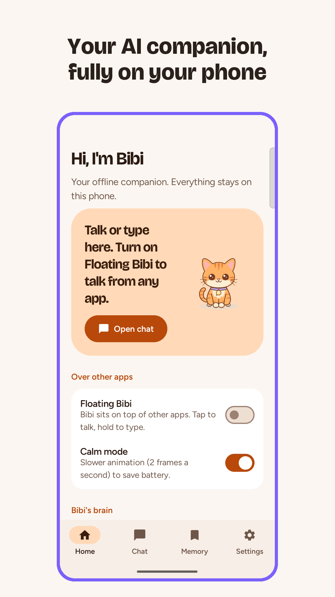
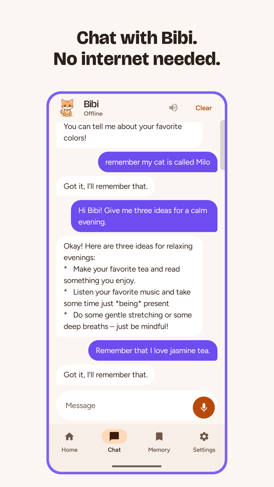
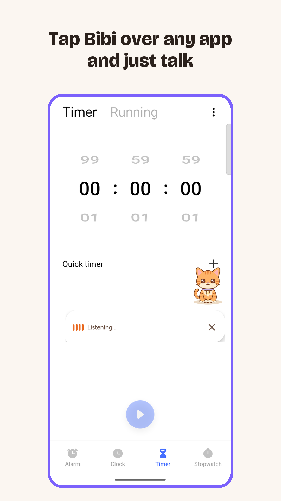
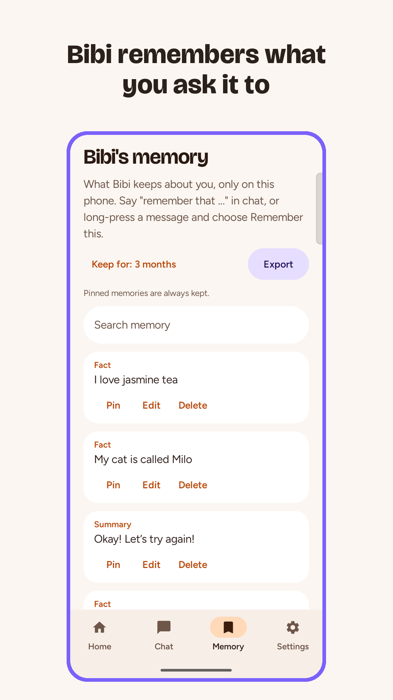
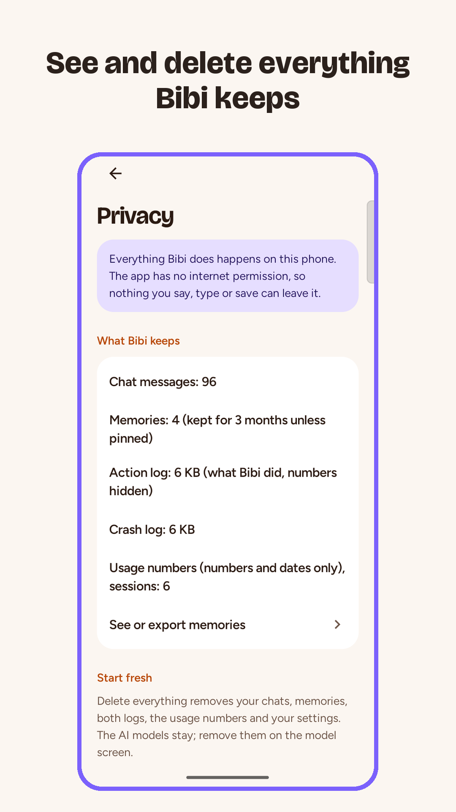
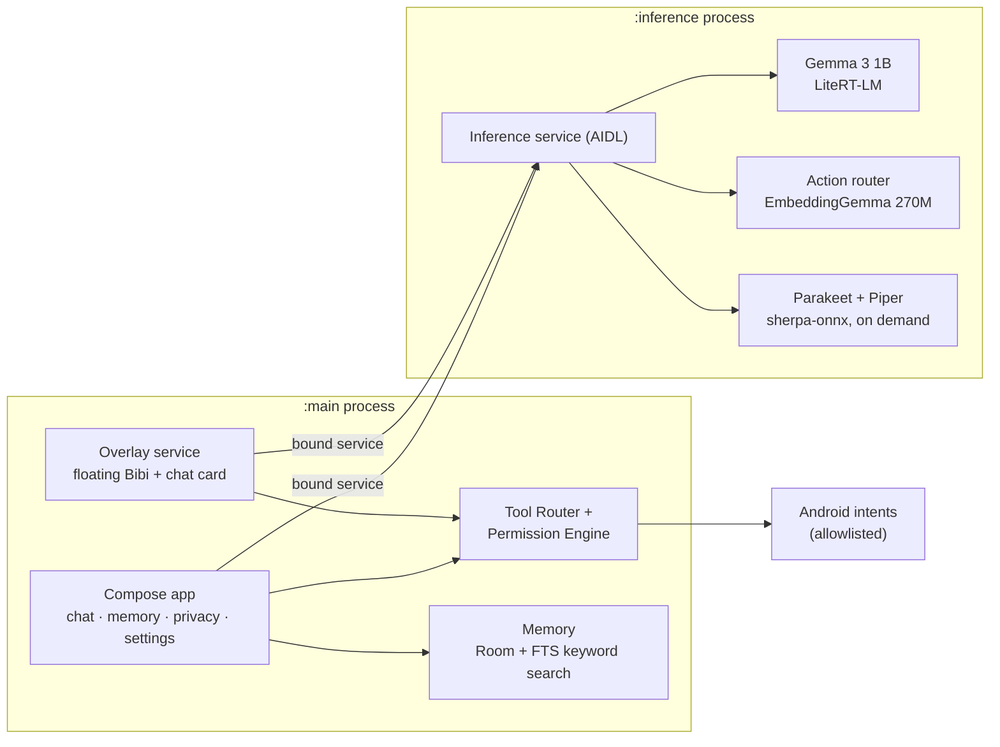

# Bibi AI

An offline AI companion for Android. Bibi is a small animated kitten that floats over your other apps. You can chat with it or talk to it, it remembers what you ask it to, and it does a few safe phone actions (timer, alarm, flashlight, open an app, dial with confirmation). Everything runs on the phone: the internet is used only to download the model once, and there is no account and no analytics.

Bibi is a portfolio piece and a technical experiment by Saad Ahmed, built with Claude Code. It's in a closed test on Google Play (version `0.3.x-p3`).

  
  
  
  
  

## What it does
- **Chat** with Gemma 3 1B (int4) on [LiteRT-LM](https://github.com/google-ai-edge/LiteRT-LM) 0.16.1, CPU only. One ongoing conversation, so the system prompt is processed once.
- **Floating Bibi** over any app: tap to talk, long-press for a chat card. A foreground service with a visible notification.
- **Voice** (optional pack): Parakeet TDT 0.6B for speech to text and Piper for speech out, both through sherpa-onnx. They load only when needed and are released after 2 quiet minutes.
- **Memory:** "remember that …" or long-press a message. You can search, edit, pin and export memories, and choose how long they're kept. Passwords, PINs, card and ID numbers are refused before they are saved.
- **Phone actions:** a router model (EmbeddingGemma 270M through MediaPipe) picks the action, and plain rules pull out the values. Every action goes through one Permission Engine. Dialing always asks first.
- **Privacy:** a Privacy screen shows what is kept, and Delete everything wipes chats, memories, logs and settings. The crash log and usage numbers leave the phone only through the share sheet, if you choose.

## Measured on a mid-range phone
All numbers are from a vivo Y17s (6 GB RAM, Helio G85, Android 15). Each links to the file it comes from.

| What | Result | Source |
|---|---|---|
| First word, Gemma 3 1B, slowest 5 % of 50 messages | 2.4 s (one ongoing chat) vs 3.5 s (new chat each time) | [S2 results](spikes/s2-llm/results/RESULTS.md) |
| Decode speed, memory | 7.0 tokens/s, 1.19 GB, 0 out-of-memory kills | [S2 results](spikes/s2-llm/results/RESULTS.md) |
| Phone actions right, out of 100 | Gemma writing the tool call: 0; router + rules: 87, then 95 after tuning, 0 wrong actions | [S4 results](spikes/s4-tools/results/RESULTS.md) |
| Voice speed (seconds per 1 s of audio) | Piper 0.25, Parakeet 0.32, Kokoro 3.77 (too slow) | [S3 results](spikes/s3-voice/results/RESULTS.md) |
| Battery cost of the floating character | +28 mA at 12 fps (about 0.5 %/h), +12 mA in Calm mode | [S1 results](spikes/s1-overlay/results/RESULTS.md) |
| Four models sharing the phone | Memory fits (≥ 1.6 GB free, no kills); the CPU doesn't (speech to text 0.32 → 0.74) | [P2 memory check](docs/measurements/2026-10-31-p2-memory-check/RESULTS.md) |

A 130-second demo (no sound): [docs/linkedin/media/bibi-demo.mp4](docs/linkedin/media/bibi-demo.mp4).

The full log of findings, including what didn't work, is in [docs/linkedin/posts.md](docs/linkedin/posts.md).

## Architecture
Two processes. The native AI runtimes run in `:inference`, so a model crash or running out of memory never takes down the floating character, and killing that process is the only reliable way to hand native memory back.

| Module | Role |
|---|---|
| `app` | Application, navigation, screens, manifest |
| `ai:inference-api`, `ai:inference-litert` | AIDL contract and the `:inference` service (LiteRT-LM, MediaPipe, sherpa-onnx) |
| `companion:overlay` | Floating character and chat card windows |
| `core:tools`, `feature:tools` | Tool-call parser, slot extraction, Permission Engine, Android actions |
| `core:database`, `feature:memory` | Room database, memory, retention, export |
| `core:common`, `core:designsystem` | Crash log, usage counters, theme, fonts, character art |
| `domain:model`, `domain:usecase`, `feature:chat`, `feature:onboarding` | Pure-Kotlin use cases, chat and first run |
| `spikes/` | The four feasibility spikes (separate Gradle builds) and their raw results |

More detail: [docs/architecture.md](docs/architecture.md) (the original design) and the feature docs in [docs/features/](docs/features/).

## Build
Needs JDK 17 and the Android SDK (compileSdk 36). The app's minSdk is 32. The build is for `arm64-v8a` only.

1. Download `sherpa-onnx-2.0.1.aar` from the [sherpa-onnx v2.0.1 release](https://github.com/k2-fsa/sherpa-onnx/releases/tag/v2.0.1) into `libs/` (git-ignored). The build stops with this message if it's missing.
2. `./gradlew assembleDebug`, then install `app/build/outputs/apk/debug/app-debug.apk`.
3. Unit tests: `./gradlew test`.

Release signing reads the `BIBI_UPLOAD_*` values from `~/.gradle/gradle.properties` ([docs/release.md](docs/release.md)). The names are listed in [.env.example](.env.example).

## Get the model
The models aren't in the app or in this repository. The chat model is `gemma3-1b-it-int4.litertlm` (584,417,280 bytes), a LiteRT-LM build of Gemma 3 1B. Download it from [litert-community/Gemma3-1B-IT](https://huggingface.co/litert-community/Gemma3-1B-IT/blob/main/gemma3-1b-it-int4.litertlm) on Hugging Face. The model is gated: log in and accept the Gemma Terms of Use first. Then either copy it to the phone and tap **Choose model file**, or host the models on your own HTTPS server and build with `-PBIBI_MODEL_BASE_URL=https://your.server/bibi` so the app downloads them (layout in [SPEC-model-download.md](SPEC-model-download.md#packs)). The app copies the file and checks its SHA-256. Closed testers get a download link instead ([docs/tester-guide.md](docs/tester-guide.md)), and the optional action and voice files are listed there too.

Gemma is provided under and subject to the [Gemma Terms of Use](https://ai.google.dev/gemma/terms). Every model and library credit is in [app/src/main/assets/licenses.txt](app/src/main/assets/licenses.txt), which is also the in-app Licenses screen.

## Privacy
The `INTERNET` permission is used only by the one-time model download (Android DownloadManager). Nothing you say, type or save leaves the phone except through a share you start. The optional phone-actions model runs on Google's MediaPipe, which may send usage statistics to Google. Policy: [docs/privacy-policy.md](docs/privacy-policy.md). The public-release audit of this repository is in [docs/public-release-audit.md](docs/public-release-audit.md).

## Project docs
- Status, decisions and open items: [docs/project_status.md](docs/project_status.md)
- Product requirements: [reference/Pip_PRD_Final.md](reference/Pip_PRD_Final.md) (the early working name was "Pip")
- Write-up and portfolio material: [docs/writeup/](docs/writeup/)

## License
The source code is licensed under the [Apache License 2.0](LICENSE). See [NOTICE](NOTICE) for what isn't covered: the name "Bibi AI", the Bibi character and its art and app icon stay all rights reserved, so please don't reuse them in your own app. The fonts are under the SIL Open Font License 1.1 ([licenses/fonts/](licenses/fonts/)), and the models and libraries keep their own licenses (see `licenses.txt`).
