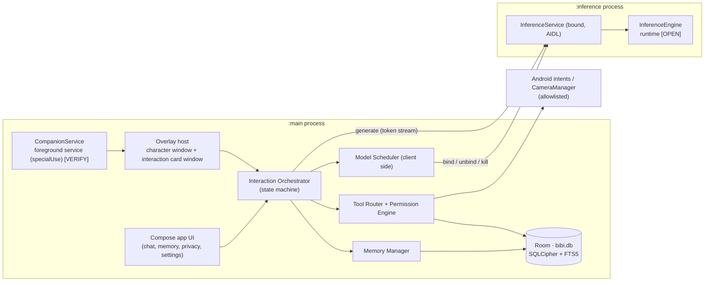
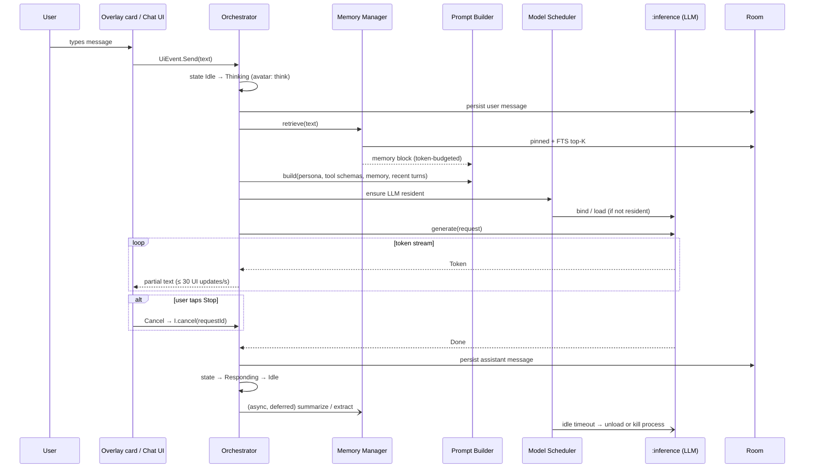

# Architecture

Source: PRD §11 (system), §12 (Android app), §13 (AI), plus Part 0 (0.4, 0.8, 0.10). Where they conflict, Part 0 wins. Undecided choices are marked **[OPEN]**; unmeasured numbers are marked **[VERIFY]**.

## 1. Goals (PRD §11.1)
1. Isolate heavy AI work so the character never stutters while the model decodes.
2. Put every capability (inference, STT, TTS, avatar renderer, memory store) behind a replaceable interface.
3. Make the idle state cheap: only a light overlay and a few event listeners are alive.
4. Centralize safety: one Permission Engine and one Tool Router. No other path to device actions.
5. Make the system testable offline and deterministically, using fake engines.

## 2. Process model (PRD §11.3, decision D-05; kept by 0.10)

| Process | Contents | Why |
|---|---|---|
| `:main` | App UI, overlay host (`CompanionService` foreground service + `WindowManager` windows), domain layer, repositories, Room, tool execution | Standard process for everything that isn't heavy |
| `:inference` | Native AI runtimes: LLM (later STT, TTS, embedding) | An OOM or native crash doesn't take down the overlay. Killing the process is the only reliable way to return native memory on 4 GB devices. |

- **Communication:** a bound service over AIDL/Binder. `SharedMemory` is used for audio buffers once voice ships.
- **Deferred:** a separate `:overlay` process is a v1.1 evaluation (§11.3), not MVP.



## 3. Module layout proposal (MVP subset of PRD §11.4)

Start with the smallest set that still enforces the boundaries. Add the other §11.4 modules only when a feature in the MVP scope needs them.

```
:app                     Application, DI wiring, manifest, process declarations
:core:common             Result types, dispatchers, Logger interface
:core:designsystem       Material 3 theme, components, motion tokens
:core:database           Room, DAOs, migrations, encryption factory
:domain:model            Pure Kotlin entities
:domain:usecase          SendMessage, ExecuteTool, Remember, ApplyRetention, ...
:ai:inference-api        InferenceEngine interface + AIDL contract
:ai:inference-<runtime>  Implementation chosen by S2 [OPEN: litert | llamacpp]
:ai:scheduler            Model Scheduler / resource governor
:companion:overlay       WindowManager overlay host, OverlayLifecycleOwner
:companion:avatar        Renderer + animation state machine [OPEN: sprite | Rive]
:feature:chat
:feature:memory
:feature:privacy
:feature:settings
:tools:api               ToolSpec schema, router, permission engine (unit-tested first)
:tools:android           Intent-based tool implementations
:testing                 FakeInferenceEngine and other fakes
```

Deferred from §11.4 until a gate or scope decision needs them: `:ai:stt-*` and `:ai:tts-*` (S3), `:ai:speaker`, `:ai:embedding` (see memory.md open question), `:companion:behavior` beyond the MVP behaviors, `:feature:onboarding` (not designed yet), `:benchmark`.

**Layering rules** (§12.1, §12.3):
- Composables observe `StateFlow<UiState>`.
- Use cases have no Android dependencies.
- Repositories never expose Room entities outside the data layer.

## 4. Data flow — chat turn



## 5. Data flow — tool call (PRD §13.5, §16.2)

1. **Shortcut path:** a deterministic NLU matcher ("set a timer for 5 minutes", "flashlight on") bypasses the LLM. S4 target: under 300 ms.
2. **LLM path:** the model emits a structured `<tool_call>`, using constrained decoding if the runtime supports it, otherwise a two-pass fallback (§13.5).
3. The Tool Router validates the call against a JSON Schema. If it's invalid, the model gets one repair prompt; if that fails, the user gets a clarifying question.
4. The Permission Engine checks the risk class (Safe, Sensitive, Critical) and any untrusted-content taint:
   - Safe and untainted → execute.
   - Sensitive or tainted → confirmation card.
5. The executor builds the intent itself from validated parameters. The LLM never supplies raw URIs, actions, or components (§16.6).
6. The audit record is appended to tool history. The result goes back to the model as data.

## 6. Interaction state machine (PRD §12.2.1)

Idle → Thinking → (AwaitingConfirmation | ExecutingTool | Responding | Speaking) → Idle. Cancel or panic-stop from any active state.
- Every transition emits an `InteractionEvent` consumed by the UI, the avatar, and logging, so the character always reflects real system state.
- Listening, Transcribing, and Speaking states exist only if S3 passes.

## 7. Model Scheduler (PRD §13.6)

- **Request flow:** a stage request (LLM; later STT/TTS) checks whether the model is resident. If not, it checks whether the model fits the RAM budget, then loads it (mmap). If it doesn't fit, the scheduler evicts by LRU weighted by reload cost.
- **Full reclaim:** if eviction needs a full memory reclaim, the scheduler restarts the `:inference` process.
- **Idle unload:** T1 (4 GB) unloads the LLM after 20 s idle (§12.10) [VERIFY on the A23].
- **Sequential loading on T1:** only one large model is resident at a time.
- **Memory pressure:** `onTrimMemory` triggers immediate eviction. `ApplicationExitInfo` from the previous run tunes context length and quantization downward after repeated low-memory kills (§12.9).
- **Sizing rule:** weights + KV cache + overhead ≤ 55% of available RAM (§13.2) [VERIFY].

## 8. Storage

- **Database:** Room, one encrypted database `bibi.db`, SQLCipher-backed factory. The key is wrapped by an Android Keystore key (§18.1).
- **Search:** FTS5 for memory and message search.
- **Conventions:** every user-content table carries `profileId` (single profile in MVP), plus `deletedAt` for soft delete and a purge job with `secure_delete` (§18.1).
- **Migrations:** schemas exported to VCS; each migration has a `MigrationTestHelper` test; destructive fallback disabled.
- **Preferences:** DataStore (§11.5).
- **Model packs:** stored in app-private storage and verified against the SHA-256 manifest before load.

## 9. Open choices

| Choice | Options (PRD) | Decided by |
|---|---|---|
| LLM runtime [OPEN] | LiteRT-LM (primary in §11.5) or llama.cpp via JNI | Spike S2 results on the A23 |
| Candidate models [OPEN] | Gemma 3 1B-class and Qwen 0.5B-class, int4 | Spike S2; license review (0.9) |
| Avatar tech [OPEN] | Sprite sheet via Compose Canvas or Rive (OD-03) | Spike S1 frame and battery cost |
| DI framework [OPEN] | Hilt or Koin (§11.5) | P1 setup |
| Embedding model for semantic memory [OPEN] | §14.3 flat vector index | RAM budget after S2 |
