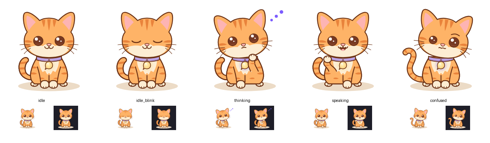

# Bibi — MVP state poses

The four base MVP states (PRD 0.8, "animated emotions beyond four states" only if a gate passes) plus one idle blink frame. They're generated from the vector master by [`tools/build_states.py`](../../../../tools/build_states.py), so they stay consistent with it:

```bash
python3 -I tools/build_states.py
```



| State | File | How it differs from the master | Charm glow |
|---|---|---|---|
| Idle | `idle.svg` | Same as the master | gold `#FFD36B` |
| Idle (blink frame) | `idle_blink.svg` | Eyes closed in soft curves: a slow cat blink. Used inside the idle loop. | gold |
| Thinking | `thinking.svg` | Head tilted left, eyes slightly smaller and looking up, flat mouth, right paw raised to the chin, three violet dots | violet `#7C5CFF` |
| Speaking | `speaking.svg` | Open mouth with a pink tongue, left paw raised in a small gesture | gold |
| Confused / error | `confused.svg` | Head tilted right, one eye smaller, raised brow, wavy mouth, tail curled into a question mark | violet |

`states.json` lists every state with its group, charm glow color and a one-line screen-reader description (PRD §17.6).

## Checks
- Each state differs by **pose and shape**, not only by color (PRD §17.6).
- At 64 px: thinking (paw and dots) and confused (question-mark tail) are clear. Speaking is told apart mainly by the raised paw; the open mouth is small at that size. The blink is subtle on purpose because it's an animation frame, not a standalone state.
- Rendered in Chromium only. Android rendering is checked during spike S1 [VERIFY].

## Not done yet
- The other states from the brief (listening, doing a task, done, needs confirmation, sleeping, being dragged) are post-MVP or gate-dependent. Build them with the same script when needed.
- Animation loops and the sprite atlas (codex-design-prompts.md prompt 3).
